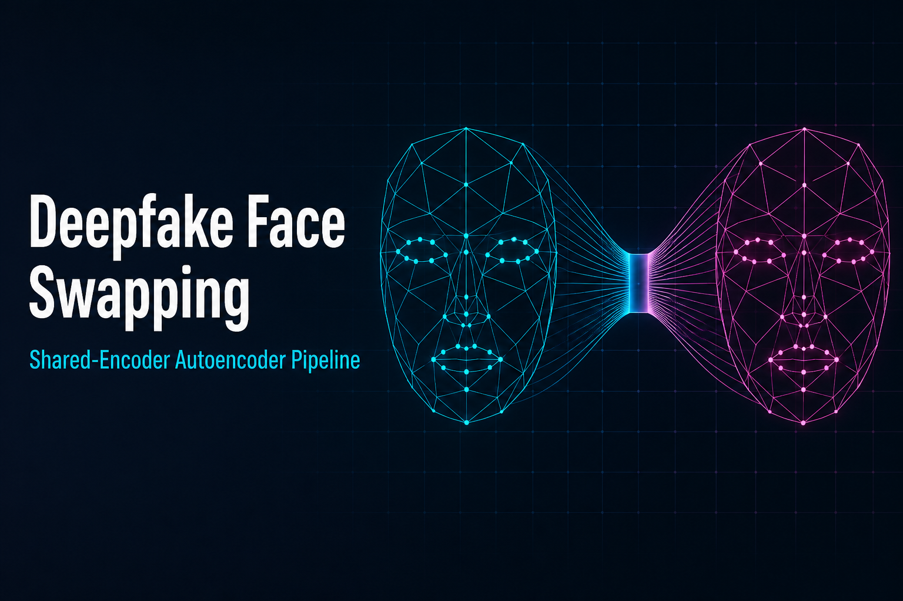
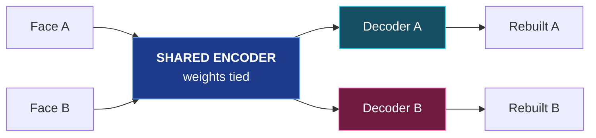
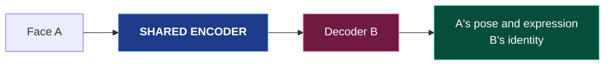
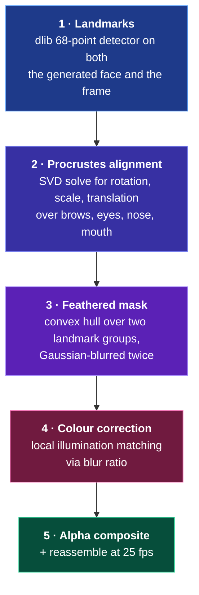
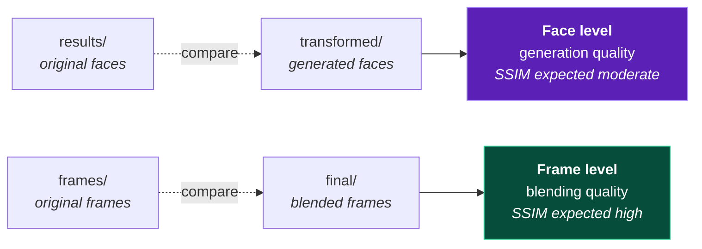

<div align="center">



<br>

**An end-to-end deepfake pipeline — raw video in, identity-swapped video out, with quantitative quality evaluation.**

<br>

[](https://www.python.org/)
[](https://www.tensorflow.org/)
[](https://keras.io/)
[](https://opencv.org/)

[](http://dlib.net/)
[](https://github.com/ipazc/mtcnn)
[](https://www.tensorflow.org/guide/mixed_precision)
[](https://www.kaggle.com/)
[](LICENSE)

</div>

---

## Contents

| | |
|:--|:--|
| [**Overview**](#overview) | What the project does and why the architecture works |
| [**Pipeline**](#pipeline) | The four stages and their Kaggle notebooks |
| [**Architecture**](#architecture) | Shared encoder, dual decoders, layer tables |
| [**Perceptual Loss**](#perceptual-loss) | Why L1 alone produces blur, and the fix |
| [**Training Strategy**](#training-strategy) | Alternating schedule, LR decay, early stopping |
| [**Blending**](#blending-the-face-back-into-the-frame) | Landmarks, Procrustes alignment, colour matching |
| [**Evaluation**](#evaluation) | SSIM / PSNR / MSE at two levels |
| [**Getting Started**](#getting-started) | Install and run |
| [**Engineering Notes**](#engineering-notes) | Trade-offs made and why |
| [**Sources & Inspiration**](#sources--inspiration) | Full attribution |

---

## Overview

This project reimplements and extends the classical **shared-encoder / dual-decoder** deepfake architecture.

A single encoder learns a *person-agnostic* latent representation of a face, while two separate decoders learn to reconstruct **Person A** and **Person B** respectively. Because the encoder's weights are shared between both training paths, it cannot afford to memorise identity — it is forced to encode only what the two people have in common: **pose, expression, gaze, and lighting**. Identity-specific detail (skin tone, face shape, features) gets pushed into the decoder weights.

That separation is what makes the swap work. At inference time you encode Person A's face and decode it with **Person B's** decoder:

$$
\hat{y} \;=\; D_B\bigl(E(x_A)\bigr) \quad\longrightarrow\quad \text{A's pose and expression, rendered as B}
$$

The generated face is then blended back into the original video frame using dlib landmarks, Procrustes alignment, a feathered mask, and local colour correction — and the frames are reassembled into a video.

---

## Pipeline

The project is split into four Kaggle notebooks that chain together, each mounting the previous notebook's output as an input dataset.

```mermaid
flowchart LR
    V(["Source videos<br/>4 clips - 6,215 frames"])

    subgraph S1["1 - Preprocessing"]
        direction TB
        A1["Frame extraction<br/><i>OpenCV</i>"] --> A2["Face detection<br/><i>MTCNN</i>"] --> A3["Crop and resize<br/>64x64"]
    end

    subgraph S2["2 - Training"]
        direction TB
        B1["Shared encoder"] --> B2["Dual decoders A / B"] --> B3["VGG16 perceptual loss<br/>mixed-precision FP16"]
    end

    subgraph S3["3 - Swapping"]
        direction TB
        C1["Cross-decode<br/>encoder to decoder_B"] --> C2["dlib 68-pt<br/>Procrustes warp"] --> C3["Feathered mask blend<br/>colour correction"]
    end

    subgraph S4["4 - Evaluation"]
        direction TB
        D1["SSIM / PSNR / MSE"] --> D2["Face-level and<br/>frame-level"]
    end

    O(["deepfake.avi"])
    R(["evaluation_report.txt<br/>metrics plot"])

    V --> A1
    A3 --> B1
    B3 --> C1
    C3 --> O
    C3 --> D1
    D2 --> R

    style V fill:#1f2937,stroke:#60a5fa,color:#fff
    style O fill:#064e3b,stroke:#34d399,color:#fff
    style R fill:#064e3b,stroke:#34d399,color:#fff
```



| # | Stage | Script | Notebook |
|:-:|:------|:-------|:---------|
| **1** | Frame extraction and MTCNN face cropping | [`01_preprocessing.py`](01_preprocessing.py) | [](https://www.kaggle.com/code/ayushragh/deepfakes-preprocessing) |
| **2** | Shared encoder + dual decoder training | [`02_model_training.py`](02_model_training.py) | [](https://www.kaggle.com/code/ayushragh/deepfakes-model-training) |
| **3** | Cross-decoding, blending, video rebuild | [`03_face_swapping.py`](03_face_swapping.py) | [](https://www.kaggle.com/code/ayushragh/deepfake-face-swapping) |
| **4** | SSIM / PSNR / MSE evaluation | [`04_evaluation.py`](04_evaluation.py) | [](KAGGLE_NOTEBOOK_4_URL) |

> [!NOTE]
> **Dataset:** [`ayushragh/presidents-data`](https://www.kaggle.com/datasets/ayushragh/presidents-data) — four source videos (2 per identity) yielding **6,215 raw frames**.
> **Landmark model:** [`shape_predictor_68_face_landmarks.dat`](https://www.kaggle.com/datasets/sergiovirahonda/shape-predictor-68-face-landmarksdat)

---

## Architecture

### Weight sharing is the whole trick

During training, both identities pass through the **same** encoder. Each decoder only ever sees its own person.



At inference, the decoder is swapped — everything else is identical:



### Encoder

Four strided convolutions halve the spatial resolution each time, then a dense bottleneck compresses the face:

$$
64 \xrightarrow{\ s=2\ } 32 \xrightarrow{\ s=2\ } 16 \xrightarrow{\ s=2\ } 8 \xrightarrow{\ s=2\ } 4
$$

The bottleneck squeezes $64 \times 64 \times 3 = 12{,}288$ input values down to a latent vector $z \in \mathbb{R}^{1024}$ — roughly a **12:1 compression** — which is what prevents the encoder from simply copying the input through.

| Layer | Filters | Kernel | Stride | Output | Activation |
|:------|:-------:|:------:|:------:|:------:|:-----------|
| `Conv2D` | 128 | 5×5 | 2 | 32×32×128 | LeakyReLU $\alpha = 0.1$ |
| `Conv2D` | 256 | 5×5 | 2 | 16×16×256 | LeakyReLU $\alpha = 0.1$ |
| `Conv2D` | 512 | 5×5 | 2 | 8×8×512 | LeakyReLU $\alpha = 0.1$ |
| `Conv2D` | 1024 | 5×5 | 2 | 4×4×1024 | LeakyReLU $\alpha = 0.1$ |
| `Flatten` → `Dense` | — | — | — | $z \in \mathbb{R}^{1024}$ | linear |
| `Dense` → `Reshape` | — | — | — | 4×4×512 | linear |

### Decoder (×2, one per identity)

Mirror-image transposed convolutions upsample back to full resolution:

| Layer | Filters | Kernel | Stride | Output | Activation |
|:------|:-------:|:------:|:------:|:------:|:-----------|
| `Conv2DTranspose` | 512 | 5×5 | 2 | 8×8×512 | LeakyReLU $\alpha = 0.1$ |
| `Conv2DTranspose` | 256 | 5×5 | 2 | 16×16×256 | LeakyReLU $\alpha = 0.1$ |
| `Conv2DTranspose` | 128 | 5×5 | 2 | 32×32×128 | LeakyReLU $\alpha = 0.1$ |
| `Conv2DTranspose` | 3 | 5×5 | 2 | 64×64×3 | **Sigmoid** (forced `float32`) |

> [!IMPORTANT]
> The final sigmoid is explicitly cast to `float32`. Under a global `mixed_float16` policy it would otherwise saturate and destroy gradients.

---

## Perceptual Loss

A plain $L_1$ or $L_2$ reconstruction loss is the default choice, and it produces **blurry faces**. The reason is that pixel-wise loss is minimised by the *conditional mean* of all plausible outputs — when the model is uncertain whether a pixel belongs to an eyelash or skin, averaging the two is the safe bet, and averaging is blur.

This implementation adds a **feature-space term** computed by a frozen, ImageNet-pretrained VGG16, tapped at `block2_conv2`:

$$
\mathcal{L}(y, \hat{y}) \;=\; \underbrace{\frac{1}{N}\sum_{i=1}^{N} \bigl| y_i - \hat{y}_i \bigr|}_{\text{pixel } L_1} \;+\; \lambda \cdot \underbrace{\frac{1}{M}\sum_{j=1}^{M} \bigl| \phi(y)_j - \phi(\hat{y})_j \bigr|}_{\text{VGG16 feature } L_1}, \qquad \lambda = 0.5
$$

where $\phi(\cdot)$ denotes the `block2_conv2` activation map. Because $\phi$ responds to edges and textures rather than raw intensity, the second term penalises *structural* difference — two images that are shifted by a pixel score almost identically, but a smeared eyelid does not. In practice this visibly sharpens eyes, teeth, and hair boundaries.

`block2_conv2` is chosen deliberately: it is shallow enough to retain spatial detail at $64\times64$ input, whereas deeper layers (`block4`/`block5`) collapse to a resolution too coarse to guide a face this small.

---

## Training Strategy

| Setting | Value | Rationale |
|:--------|:------|:----------|
| Optimiser | Adam, $\eta_0 = 5\times10^{-5}$, $\beta_1 = 0.5$, $\beta_2 = 0.999$ | Low $\beta_1$ is standard for generative training — less momentum, fewer oscillations |
| Precision | `mixed_float16` | ≈2× throughput on T4 tensor cores |
| Batch size | 32 | |
| Max epochs | 300, **alternating** A → B each epoch | Keeps the shared encoder balanced |
| Train / val split | 85 / 15 | |
| LR decay | Halved after every 15 stagnant epochs | Manual plateau schedule |
| Early stopping | Patience 40, **per-decoder** best-weight checkpointing | A and B converge at different rates |

**Learning-rate schedule.** With $k$ counting consecutive epochs without validation improvement:

$$
\eta_k \;=\; \eta_0 \cdot \left(\tfrac{1}{2}\right)^{\lfloor k / 15 \rfloor}
$$

**Why alternate rather than train jointly?** Training A for one epoch, then B for one epoch, means the shared encoder receives gradient updates from both identities at equal frequency. Training one to convergence first would let the latent space specialise around that identity, and the second decoder would then be fighting an encoder that has already thrown away the features it needs.

---

## Blending the Face Back Into the Frame

Naïvely pasting the generated $64\times64$ patch produces obvious rectangular seams and a colour mismatch. Stage 3 instead runs a five-step geometric and photometric alignment:



### Procrustes alignment

Given landmark sets $P = \{p_i\}$ from the generated face and $Q = \{q_i\}$ from the target frame, we want the similarity transform that best superimposes them:

$$
\min_{s,\,R,\,t} \; \sum_{i=1}^{n} \bigl\lVert s\,R\,p_i + t - q_i \bigr\rVert_2^2
\qquad \text{subject to} \qquad R^{\top}R = I
$$

This is the **orthogonal Procrustes problem**, and it has a closed form. Centre and scale-normalise both point sets, then take the SVD of their cross-covariance:

$$
U \Sigma V^{\top} = \tilde{P}^{\top}\tilde{Q}
\qquad\Longrightarrow\qquad
R = \bigl(UV^{\top}\bigr)^{\top}, \qquad s = \frac{\sigma_Q}{\sigma_P}, \qquad t = \bar{q} - s R\,\bar{p}
$$

Note the constraint is a *similarity* transform, not a full affine one — allowing shear would let the warp distort the face to fit the landmarks, which looks worse than a slightly imperfect rigid fit.

### Colour correction

Rather than Poisson blending, the implementation matches local illumination by dividing out the source's own low-frequency content and multiplying in the target's:

$$
I_{\text{corrected}} \;=\; I_{\text{face}} \odot \frac{G_\sigma * I_{\text{frame}}}{G_\sigma * I_{\text{face}}}
$$

where $G_\sigma$ is a Gaussian kernel and $\odot$ is element-wise product. The blur radius is set proportional to the inter-pupillary distance, so it scales automatically with face size:

$$
\sigma \;=\; 0.6 \cdot \bigl\lVert \; \overline{\text{left eye}} - \overline{\text{right eye}} \; \bigr\rVert_2
$$

This is far cheaper than Poisson blending and, because only low frequencies are transferred, it corrects for lighting without smearing the generated detail.

### Compositing

With the feathered mask $M \in [0,1]$:

$$
I_{\text{out}} \;=\; (1 - M) \odot I_{\text{frame}} \;+\; M \odot I_{\text{corrected}}
$$

Frames where landmark detection fails — profile views, motion blur, occlusion — **fall through to the untouched original**, so the output video never drops or stutters.

---

## Evaluation

A single similarity score is misleading for face swapping, because the whole *point* is that the face should change. So quality is measured on two levels:



- **Face level** (`results/` vs `transformed/`) — how much pose and structure the autoencoder preserves while *deliberately* changing identity. A moderate SSIM here is correct; a very high one would mean the swap barely happened.
- **Frame level** (`frames/` vs `final/`) — how invisibly the new face integrates into an otherwise untouched frame. This should be high, since only a small region of each frame changes.

<details>
<summary><b>Metric definitions</b></summary>

<br>

**Mean Squared Error** — absolute pixel difference, lower is better:

$$
\mathrm{MSE}(x, y) = \frac{1}{N}\sum_{i=1}^{N}\bigl(x_i - y_i\bigr)^2
$$

**Peak Signal-to-Noise Ratio** — log-scaled MSE in decibels, higher is better. Above 30 dB is generally considered good:

$$
\mathrm{PSNR}(x, y) = 10 \cdot \log_{10}\!\left(\frac{L^2}{\mathrm{MSE}(x,y)}\right), \qquad L = 255
$$

**Structural Similarity Index** — compares luminance, contrast and structure in local windows, range $[0, 1]$, higher is better:

$$
\mathrm{SSIM}(x, y) = \frac{\bigl(2\mu_x\mu_y + C_1\bigr)\bigl(2\sigma_{xy} + C_2\bigr)}{\bigl(\mu_x^2 + \mu_y^2 + C_1\bigr)\bigl(\sigma_x^2 + \sigma_y^2 + C_2\bigr)}
$$

SSIM is the most meaningful of the three here, because MSE and PSNR both punish a perceptually invisible one-pixel shift as harshly as a genuine artefact.

</details>

### Results

| Level | What it measures | MSE ↓ | PSNR (dB) ↑ | SSIM ↑ |
|:------|:-----------------|:-----:|:-----------:|:------:|
| **Face level** | Generation quality | `TBD` | `TBD` | `TBD` |
| **Frame level** | Blending quality | `TBD` | `TBD` | `TBD` |

Stage 4 also writes `evaluation_report.txt` and a six-panel `evaluation_metrics_plot.png` of per-frame metric traces, which makes it easy to spot exactly which frames the landmark detection or blending degraded on.

---

## Getting Started

### Installation

```bash
git clone https://github.com/0xReso/deepfake-face-swap-autoencoder.git
cd deepfake-face-swap-autoencoder
pip install -r requirements.txt
```

`dlib` compiles from source and needs CMake plus a C++ toolchain:

```bash
# macOS
brew install cmake

# Ubuntu / Debian
sudo apt-get install -y build-essential cmake
```

Download the dlib landmark model before stage 3:

```bash
curl -LO http://dlib.net/files/shape_predictor_68_face_landmarks.dat.bz2
bunzip2 shape_predictor_68_face_landmarks.dat.bz2
```

### Running the pipeline

Each script consumes the previous stage's output. Update the `/kaggle/input/...` paths at the top of each file to point at your local directories before running outside Kaggle.

```bash
python 01_preprocessing.py    # videos  →  results_1/, results_2/   (64×64 face crops)
python 02_model_training.py   # faces   →  encoder / decoder_a / decoder_b .weights.h5
python 03_face_swapping.py    # weights →  deepfake.avi
python 04_evaluation.py       # frames  →  evaluation_report.txt + metrics plot
```

### Repository layout

```
.
├── 01_preprocessing.py     # Frame extraction + MTCNN detection & cropping
├── 02_model_training.py    # Shared encoder, dual decoders, VGG16 perceptual loss
├── 03_face_swapping.py     # Cross-decoding, landmark warp, blending, video rebuild
├── 04_evaluation.py        # SSIM / PSNR / MSE at face and frame level
├── assets/
├── requirements.txt
└── README.md
```

---

## Engineering Notes

Choices made while adapting the reference implementation to fit a constrained 2×T4 Kaggle session:

- **`FACE_SIZE` reduced from 120 → 64.** Activation memory scales with $O(n^2)$, so this cuts it by roughly $3.5\times$ and made 300-epoch training feasible inside the session limit. This is the single biggest quality trade-off in the project.
- **Mixed precision with an explicit `float32` output head.** `mixed_float16` alone saturates the final sigmoid; pinning that one layer to `float32` keeps gradients well-scaled while the rest of the network still runs in half precision.
- **Batched inference in stage 3.** Predicting 64 faces per call instead of one-by-one avoids per-call graph dispatch overhead across thousands of frames.
- **Fail-open frame handling.** Landmark detection fails on profile views and motion blur. Every such frame falls back to the untouched original, so the output video never drops frames.
- **Independent checkpointing per decoder.** The two autoencoders converge at different rates, so each tracks its own best validation loss rather than sharing one early-stopping criterion.

---

## Sources & Inspiration

This project builds directly on prior work. Attribution below separates **what was adapted** from **what was added here**.

### Adapted from

| Source | What was taken |
|:-------|:---------------|
| **Sergio Virahonda** — Kaggle deepfake series: [preprocessing](https://www.kaggle.com/code/sergiovirahonda/deepfakes-preprocessing) · [model training](https://www.kaggle.com/code/sergiovirahonda/deepfakes-model-training) · [face swapping](https://www.kaggle.com/code/sergiovirahonda/deepfakes-face-swapping) | Overall three-notebook pipeline structure, the shared-encoder / dual-decoder formulation, and the MTCNN preprocessing approach |
| **Matthew Earl** — [*Switching Eds: Face swapping with Python, dlib, and OpenCV*](https://matthewearl.github.io/2015/07/28/switching-eds-with-python/) · [`matthewearl/faceswap`](https://github.com/matthewearl/faceswap) | The entire landmark-based blending stage: Procrustes alignment, convex-hull feathered masking, and the blur-ratio colour correction |
| **[`deepfakes/faceswap`](https://github.com/deepfakes/faceswap)** | The original shared-encoder autoencoder concept this whole family of methods descends from |

### Added in this project

- VGG16 **perceptual loss** replacing plain pixel reconstruction loss
- **Mixed-precision (FP16)** training with a `float32`-pinned output head
- **Alternating A/B training schedule** with adaptive LR decay and per-decoder early stopping
- **Batched GPU inference** for the transformation stage
- A complete **quantitative evaluation stage** (stage 4) that did not exist in the source material

### Underlying papers and models

| Reference | Used for |
|:----------|:---------|
| Zhang et al., [*Joint Face Detection and Alignment using Multi-task Cascaded Convolutional Networks*](https://arxiv.org/abs/1604.02878) (2016) — [`ipazc/mtcnn`](https://github.com/ipazc/mtcnn) | Face detection in stages 1 and 3 |
| Kazemi & Sullivan, [*One Millisecond Face Alignment with an Ensemble of Regression Trees*](https://openaccess.thecvf.com/content_cvpr_2014/papers/Kazemi_One_Millisecond_Face_2014_CVPR_paper.pdf) (CVPR 2014) | The dlib 68-point landmark predictor |
| Johnson et al., [*Perceptual Losses for Real-Time Style Transfer and Super-Resolution*](https://arxiv.org/abs/1603.08155) (2016) | The perceptual loss formulation |
| Simonyan & Zisserman, [*Very Deep Convolutional Networks for Large-Scale Image Recognition*](https://arxiv.org/abs/1409.1556) (2014) | VGG16, used as the frozen feature extractor |
| Micikevicius et al., [*Mixed Precision Training*](https://arxiv.org/abs/1710.03740) (2017) | FP16 training strategy |
| Wang et al., [*Image Quality Assessment: From Error Visibility to Structural Similarity*](https://www.cns.nyu.edu/pub/eero/wang03-reprint.pdf) (2004) | SSIM metric |

---

## Ethics

> [!WARNING]
> This is an academic project demonstrating generative modelling and computer-vision techniques.

Deepfakes carry real potential for harm — non-consensual imagery, disinformation, and fraud. This code is published for education and for research into **detection**. Use it only on footage you have the right to use, and only with clear disclosure that the output is synthetic.

---

## License

Released under the [MIT License](LICENSE).

<div align="center">
<br>
<sub>Built by <a href="https://github.com/0xReso">Ayush Raghuvanshi</a></sub>
</div>
